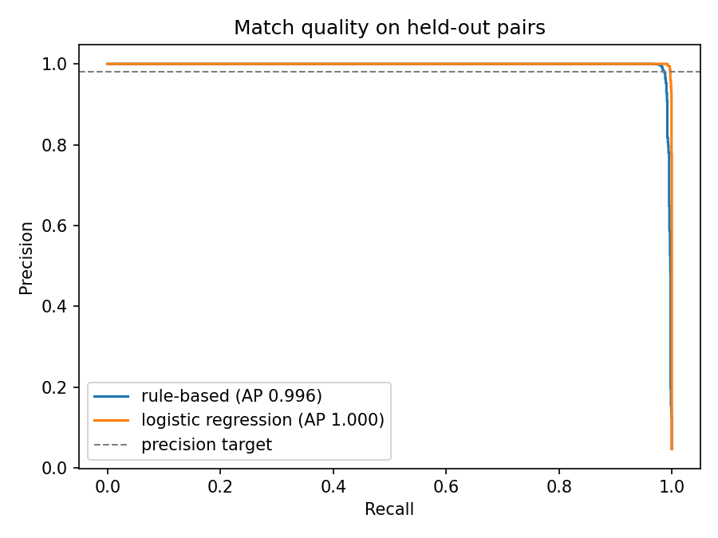
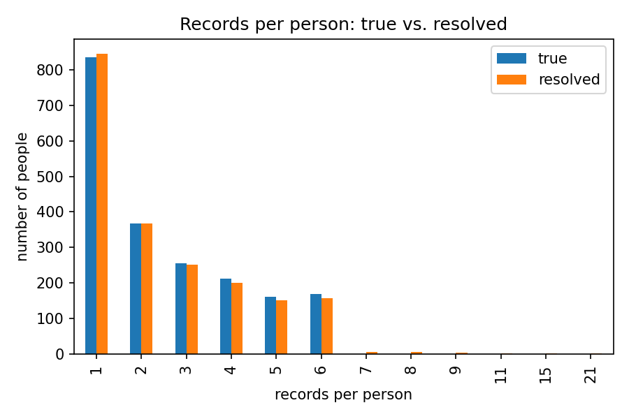

# Entity Resolution on Synthetic Person Records (FEBRL3)

**Author:** Fengting (Jessica) Jiang · **Runtime:** Google Colab (CPU) · **Data:** FEBRL3 (synthetic, public)

> Personal project. Groups 5,000 messy person records into the 2,000 people behind
> them — and measures how accurate that grouping is against known ground truth.

## The problem

Customer and identity data rarely comes with a clean, shared ID. The same person
shows up several times with typos, missing fields, and formatting differences.
**Entity resolution** decides which records belong to the same real person and gives
each person one ID — the core operation behind identity graphs in advertising,
fraud detection, and customer data platforms.

Getting identity wrong is costly in both directions:

- **False merge** (two people treated as one): wrong targeting, wrong measurement,
  and a privacy risk — one person's data attached to another.
- **Missed match** (one person treated as two): inflated counts, fragmented
  history, weaker signals.

The core of this project is choosing and documenting that trade-off, not just
running a matching library. Every material decision is documented in the
notebook alongside the step it belongs to, with the options considered and
the rationale.

## Approach

| Step | What | Key metric |
|---|---|---|
| 1 | Load and profile FEBRL3 (5,000 records, 2,000 people, 6,538 true duplicate pairs) | missing rate per field |
| 2 | Clean and standardize; add surname Soundex; build a full-address string | — |
| 3 | Blocking: postcode + surname Soundex + sorted neighbourhood on given name | pair reduction, pair completeness |
| 4 | Field comparisons: Jaro-Winkler (names, suburb), Levenshtein (address_1), token-sort ratio (full address, rapidfuzz), exact (DOB, postcode, street number) | feature separation |
| 5 | Two scorers compared: hand-weighted rules vs. logistic regression (70/30 split) | average precision |
| 6 | Cutoff chosen for highest recall at precision ≥ 98% | precision, recall, F1 |
| 7 | Connected-components clustering (networkx) → one `resolved_id` per person | exact-reconstruction rate, over-merges, splits |
| 8 | Error analysis by cause | error counts by category |

Design choice worth noting: `soc_sec_id` is **deliberately excluded** from matching —
and the notebook checks it before excluding it. The field looks clean (0% missing,
all 7-digit, no value shared by two different people), but it is not the perfect ID
it appears to be: 254 of the 2,000 people carry two or more different SSNs across
their own records, so exact matching on it would split those people. Real identity
data (devices, cookies, partner records) rarely has a clean unique ID at all;
matching on one would make the problem trivial and the results misleading.

## Results

**Blocking** — 12.5M possible pairs reduced to 132,861 candidates:

| Strategy | Candidate pairs | Reduction ratio | Pair completeness |
|---|---|---|---|
| Postcode only | 16,115 | 0.9987 | 0.763 |
| Surname Soundex only | 53,559 | 0.9957 | 0.678 |
| Sorted given name only | 71,235 | 0.9943 | 0.676 |
| **All three combined** | **132,861** | **0.9894** | **0.954** |

**Feature separation** — only 4.69% of candidate pairs are true matches. Mean
similarity by pair type (the sanity check that every field separates):

| Feature | Non-match mean | Match mean |
|---|---|---|
| date_of_birth | 0.000 | 0.865 |
| suburb | 0.443 | 0.915 |
| surname | 0.598 | 0.867 |
| full_address | 0.375 | 0.853 |
| address_1 | 0.260 | 0.840 |
| given_name | 0.658 | 0.823 |
| postcode | 0.088 | 0.800 |
| street_number | 0.012 | 0.742 |

Two readings: an exact date-of-birth agreement is near-proof (non-matches
essentially never share one), while given names separate weakly *inside this
pool* — blocking already pre-selected name-lookalikes, so even non-matches
average 0.66. Separation comes from combining fields, not from any one field.

**Scoring** (held-out pairs, average precision): rules 0.9961 · logistic regression **0.9997**

**What the learned model weighted most** (logistic regression coefficients):

| Feature | Coefficient |
|---|---|
| full_address | 11.59 |
| date_of_birth | 10.32 |
| surname | 6.40 |
| suburb | 5.91 |
| postcode | 4.87 |
| given_name | 4.74 |
| address_1 | 3.73 |
| street_number | 3.43 |

The composite full-address string beats its own parts — agreement on a whole
address at once is far rarer by chance than agreement on any single piece.
All coefficients are positive; correlated features (full address vs. its
components) split credit, so these are not pure independent importances.

**Matching at the chosen cutoff (0.412, logistic regression, test pairs):**

| Precision | Recall | F1 | End-to-end recall (× blocking completeness) |
|---|---|---|---|
| 0.980 | 0.997 | 0.989 | 0.951 |

**Person level** (after clustering): 1,990 resolved clusters vs. 2,000 true people —
**92.7% of people reconstructed exactly**, 50 over-merged clusters, 45 split people.




## Error analysis — where the errors actually are

Of 316 missed true pairs, **301 (95%) were removed by blocking** and only 15 scored
below the cutoff: at this operating point, *blocking, not scoring, is the recall
bottleneck*. The fixes that matter are therefore new blocking passes (e.g., date of
birth), not a better classifier.

- **Missed, below cutoff:** wholesale attribute change (a duplicate with a different
  first name *and* different DOB), first/last names swapped with typos, and records
  with surname and DOB both missing. Next fixes: a swapped-name feature and a
  partial-date comparison.
- **False merges (111 pairs → 50 over-merged clusters):** driven by coincidental
  postcode + street-number + address-pattern agreement between different people —
  the household problem. Identity graphs usually need a household layer separate
  from person IDs; that is a design question, not just an error.

## The trade-off chosen

The cutoff (0.412) is the highest-recall point that keeps precision at or above
98%. Precision is protected first because a false merge attaches one person's data
to another — worse for targeting accuracy and privacy than a missed match, which
only leaves a person split in two. The 98% target is a business choice, and the
sensitivity table (test pairs) shows why 0.412 is the knee of that trade-off:

| Cutoff | Precision | Recall | Pairs called matches |
|---|---|---|---|
| 0.300 | 0.9694 | 0.9973 | 1,925 |
| **0.412** | **0.9800** | **0.9973** | **1,904** |
| 0.500 | 0.9868 | 0.9968 | 1,890 |
| 0.700 | 0.9936 | 0.9963 | 1,876 |
| 0.900 | 0.9979 | 0.9925 | 1,861 |
| 0.950 | 1.0000 | 0.9904 | 1,853 |

Below 0.412, recall does not improve at all — no true pair scores in that
range — so a lower cutoff only adds false merges. Above it, every step trades
real matches for precision beyond the target. 0.412 is where recall saturates.

## How I would run this in production

- **Monitor match quality weekly:** match rate, cluster-size distribution and
  drift, share of new records joining existing clusters.
- **Ground truth without labels:** review a random sample of matches and
  non-matches each cycle to estimate precision and recall.
- **Alert on anomalies:** a cluster that suddenly grows large is a chaining signal
  and should block downstream use until reviewed.
- **Next modeling steps:** unsupervised probabilistic matching (Fellegi–Sunter /
  Splink) for settings without labels, a household layer on top of person IDs,
  and GraphFrames for distributed clustering.

## Run it

Open `entity_resolution_febrl.ipynb` in Google Colab and run all cells, or:

```bash
pip install -r requirements.txt
```

Dataset loads directly from the Python Record Linkage Toolkit
(`recordlinkage.datasets.load_febrl3`). Fixed random seed (42); all numbers above
were produced by a full run of this notebook in Colab and independently
reproduced in a clean local environment — including a fresh top-to-bottom run
of the final cleaned notebook — with every reported figure in agreement. They
are also printed by the notebook's own summary step.
FEBRL is fully synthetic (no real people); created by Peter Christen (ANU) for
record-linkage research.

## Tech

Python · recordlinkage · rapidfuzz · jellyfish (Soundex) · scikit-learn ·
networkx · pandas · matplotlib
