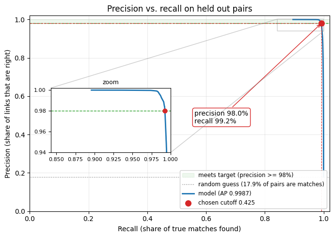
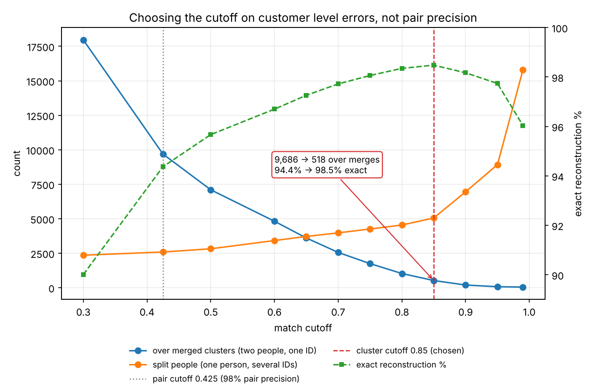
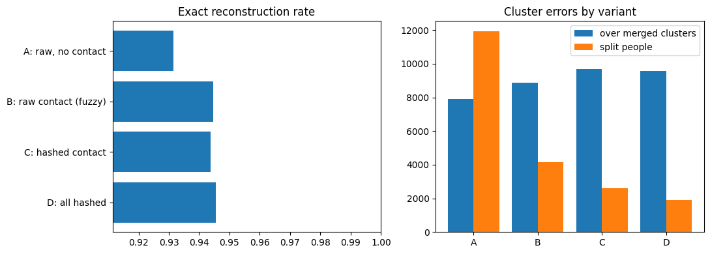
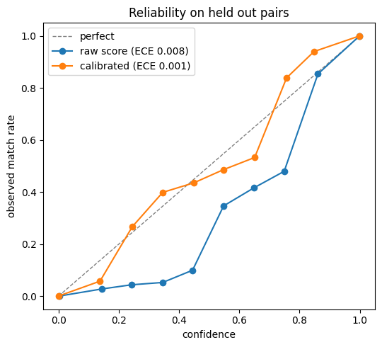

# Entity Resolution at Scale: 1M Synthetic Person Records in PySpark

**Author:** Fengting (Jessica) Jiang · **Runtime:** Google Colab (CPU) or Databricks · **Data:** synthetic, built from the FEBRL3 vocabulary

[](https://colab.research.google.com/github/rinesl/Entity-resolution-febrl3/blob/main/febrl3-entity-resolution-1M_v2.ipynb) **v2: 1M records, PySpark** (main notebook)

[](https://colab.research.google.com/github/rinesl/Entity-resolution-febrl3/blob/main/entity_resolution_febrl.ipynb) v1: 5,000 records, pandas

> Personal project. Groups 1,070,421 messy person records into the 400,000 people behind them,
> measures the errors on the final customer IDs (not just on pairs), and tests whether matching on
> salted hashes of email and phone costs any accuracy. Everything runs in PySpark, and all data is synthetic.

## Headline results

| | Result |
|---|---|
| Scale | 1,070,421 records, 400,000 people, 572.9 billion possible pairs cut to 7.1M candidates |
| Blocking | 99.1% of true pairs kept (93.2% without the hashed email/phone passes) |
| Matching | 98.0% precision, 99.2% recall on held out pairs (average precision 0.9987) |
| **Cutoff chosen on customer IDs** | **over merged clusters 9,686 → 518 (down 95%), exact reconstruction 94.4% → 98.5%** |
| Privacy | matching on salted hashes of email and phone cost **no recall** vs. raw fuzzy matching (+0.6 points) |
| Confidence tiers | 17.3% of candidate pairs auto linked at 99.98% precision; 29,000 pairs (0.4%) sent to review, 82% of them real matches |
| Stability | 0.038% of IDs changed when next month's data arrived, but 199 of 201 merges were wrong, so that's the metric to alert on |
| Households | 91% of real family members land in the same household; 78.7% are also kept as separate people |

## The problem

Customer and identity data rarely has a clean shared ID. The same person shows up many times with typos,
missing fields, different phone formats, a new address or a new email. **Entity resolution** decides which
records belong to the same real person and gives each person one ID. It's the core step behind identity
graphs in advertising, fraud and AML, and customer data platforms.

Both kinds of mistakes cost something:

| Error | What happens | Why it matters |
|---|---|---|
| Over merge (false merge) | two people end up with one ID | wrong targeting, and one person's data is exposed to another (privacy risk) |
| Under merge (split) | one person ends up with several IDs | inflated counts, broken customer history |

## What changed from v1

v1 resolved 5,000 FEBRL3 records in pandas. After review, I got three pieces of feedback and built v2 around them:

| Feedback | What I did in v2 |
|---|---|
| 5,000 records doesn't show scale | Reran the whole pipeline on about 1M records in PySpark: blocking joins, Spark ML, connected components in Spark |
| Report errors at cluster level | Measured over merge vs. under merge on the final clusters, plus B cubed precision and recall, and chose the cutoff on those |
| Answer the privacy requirement | Hashed email and phone with a secret key (HMAC SHA256) and compared accuracy against matching on raw fields |

I also added three tests based on how identity graphs run in practice: **match confidence** (calibrated scores and review tiers),
**graph stability** (do IDs stay the same when the graph is rebuilt) and a **household layer** above person IDs.

## Approach (v2)

| Step | What | Key metric |
|---|---|---|
| 1 | Generate 1.07M synthetic records: households, moves, name changes, typos, email/phone format noise | measured vs. design error rates |
| 2 | Clean, then hash identifiers with HMAC SHA256 (blocking keys hashed too) | token match rate, raw vs. cleaned |
| 3 | Six blocking passes as Spark self joins | pair completeness, reduction ratio |
| 4 | 29 pair features: fuzzy (Jaro Winkler, Levenshtein, token sort) and token equality | feature separation |
| 5 | Spark ML logistic regression, cutoff at 98% pair precision | average precision, precision, recall |
| 6 | Connected components in Spark → one ID per person | over merged clusters, split people, B cubed |
| 7 | Cutoff sweep on cluster results | exact reconstruction by cutoff |
| 8 | Four privacy variants: no contact data, raw fuzzy, hashed contact, everything hashed | end to end recall, cluster errors |
| 9 | Calibration and confidence tiers | ECE, precision per tier |
| 10 | Rebuild scenarios with stable ID mapping | ID churn, fixes vs. damage |
| 11 | Household layer over person IDs | household B cubed, family pair outcomes |
| 12 | Error analysis on individual pairs | errors by cause |

## Results

### Blocking: 572.9 billion possible pairs → 7.1M candidates

| Pass | Candidate pairs | Pair completeness |
|---|---|---|
| Surname Soundex + birth year/month | 1,807,955 | 0.727 |
| Postcode + first name Soundex | 4,638,403 | 0.731 |
| Exact DOB + first initial | 2,062,529 | 0.768 |
| First + last name Soundex + street number | 765,261 | 0.587 |
| Hashed email | 908,595 | 0.707 |
| Hashed phone | 1,020,399 | 0.665 |
| Passes 1 to 4 (no email/phone) | 6,855,735 | 0.932 |
| **All six combined** | **7,096,456** | **0.991** |

No single key is enough, because each field fails in its own way (typo, move, name change). The hashed email and phone
passes add only about 240k pairs but raise completeness by 5.9 points: they catch people who moved and changed their name.

### Matching

Main model: raw names, address and DOB, plus **hashed** email and phone (the setup I'd expect in production).

| Average precision | Cutoff | Precision | Recall | End to end recall |
|---|---|---|---|---|
| 0.9987 | 0.425 | 0.980 | 0.992 | 0.984 |

The strongest evidence is a shared email token (weight 10.3). A shared phone token is much weaker (3.4) because households
share landlines: on its own, a shared phone was right only 59% of the time.



### Customer level errors and the cutoff decision

At the pair cutoff (0.425), 94.4% of people were rebuilt exactly, but 9,686 clusters held more than one person.
25,769 wrong links became 102,454 wrong record pairs after clustering (each wrong link does about 4x damage), and 77% of
the wrong links were family members sharing a surname and address.

So I chose the cutoff on customer level errors instead of pair precision:

| Cutoff | Over merged clusters | Split people | Exact reconstruction |
|---|---|---|---|
| 0.425 (pair rule) | 9,686 | 2,585 | 94.4% |
| 0.75 | 1,744 | 4,257 | 98.1% |
| 0.80 | 1,027 | 4,541 | 98.4% |
| **0.85 (chosen)** | **518** | **5,052** | **98.5%** |
| 0.90 | 191 | 6,947 | 98.2% |
| 0.99 | 40 | 15,780 | 96.0% |



Moving from 0.425 to 0.85 removes 95% of wrong merges for about 2,500 more split people. Results are flat from
0.75 to 0.90, so the choice isn't sensitive to the exact number. Past 0.85, each merge avoided costs about 6 extra splits.
A false merge is the costlier error, so this is also the better business trade.

### Privacy: raw vs. hashed

Cleaning before hashing matters: hashing raw values matched only 66% of true email pairs and 53% of true phone pairs.
Cleaning first raised that to 83% and 84%.

| Variant | Raw PII used | End to end recall | Exact reconstruction | Split people |
|---|---|---|---|---|
| A: no contact data | names, address, DOB | 0.955 | 93.1% | 11,941 |
| B: raw email/phone, fuzzy | names, address, DOB, email, phone | 0.978 | 94.5% | 4,171 |
| **C: hashed email/phone** | names, address, DOB | **0.984** | 94.4% | 2,585 |
| D: everything hashed | none | 0.987 | 94.6% | 1,918 |

Hashing email and phone cost nothing here: exact token matches gave the model a cleaner signal than edit distance,
and phonetic and partial date tokens recovered most of the typo tolerance in D. **Caveat:** synthetic typos are simple
one character edits. Real data has nicknames and transliterations, where fuzzy matching helps more, so I'd expect a
small cost on real data and would measure it.



### Confidence tiers

Calibration (Platt scaling) cut calibration error from 0.008 to 0.0009. Overall error is flattered by the 99% of easy
pairs, though: in the uncertain middle band, confidence was still off by about 7 points.

| Tier | Pairs | Precision |
|---|---|---|
| Auto link (confidence ≥ 0.95) | 1,231,134 | 99.98% |
| Review (0.50 to 0.95) | 29,000 | 81.8% |
| No link (< 0.50) | 5,836,322 | 0.3% are matches |



### Graph stability

| | Next month's data (52,811 new records) | Model refresh, same data |
|---|---|---|
| Stable ID changed | 0.038% | 0.018% |
| Changes that fixed an error | 2 | 55 |
| Changes that caused an error | 199 | 37 |

IDs are very stable, but stable isn't the same as correct: almost every change from new data was a wrong merge between
family members. The metric to alert on is "merges that joined different people", not churn alone. A model refresh moved
IDs with zero real world change, so every model or cutoff change should be checked for ID churn before it ships.

### Households

Household B cubed precision 0.9915 and recall 0.9865, with 96.7% of households rebuilt exactly. Of 65,211 real family member
pairs, **78.7% were kept as separate people and linked into one household**, 12.3% were wrongly merged into one person
(at the loose pair cutoff), and 9.0% weren't linked (mostly address differences after a move).

### Error analysis

| Error | Count | Main cause | Next fix |
|---|---|---|---|
| False merges | 25,769 pairs | family members at the same address with a DOB one digit apart and similar first names | only count a near DOB when first names agree; household layer |
| Missed, below cutoff | 9,705 pairs | 2 to 3 problems at once: missing DOB, typos, a move with a new email | a `dob_both` flag, so a missing DOB isn't scored like a different one |
| Missed at blocking | 11,620 pairs (54% of misses) | typos or blanks in every blocking key | one more blocking pass |

## How I'd run this in production

| Area | Plan |
|---|---|
| Data and keys | raw identifiers stay in a restricted zone; identifiers are cleaned, then tokenized at ingestion with one shared key from a secret manager |
| Cutoff | set on customer level outcomes, not pair precision alone |
| Tiers | auto link high confidence pairs, send the middle band to review sized to reviewer capacity, drop the rest |
| Incremental runs | match only new records, keep a stable ID mapping, and run periodic full rebuilds (incremental runs never undo a wrong link) |
| Monitoring | match rate, cluster size distribution, stable ID changes, merges that joined different people, calibration in the middle band, PSI on features |
| Ground truth | review a sample of matches and non matches every cycle, oversampling the uncertain band |

## Limitations

1. **The data is synthetic and easier than real data.** I set the error rates myself; real data has nicknames, transliterations, PO boxes and shared business phones.
2. **Labels come from ground truth.** In practice I'd train and set the cutoff from a manual review sample.
3. **Some checks weren't stressed.** The generator makes no apartment buildings or placeholder values, so the household guard rail never triggered.
4. **Single machine.** Runs in Spark local mode on Colab; the code is the same on a cluster, but I haven't timed it on one.

## Version 1: 5,000 records in pandas

The first version (`entity_resolution_febrl.ipynb`) resolved the 5,000 FEBRL3 records (2,000 people) with recordlinkage,
rapidfuzz and networkx: three blocking passes (95.4% pair completeness), logistic regression (average precision 0.9997),
a cutoff of 0.412 at 98% precision, and 92.7% of people rebuilt exactly. It also checked and deliberately excluded
`soc_sec_id`, which looks like a clean ID but would have split 254 people. The error analysis there found the household
problem and the need for cluster level evaluation, which led to v2.

## Run it

Open the v2 notebook in Colab with the badge above and run all cells, or install locally:

```bash
pip install -r requirements.txt   # PySpark also needs Java 11 or 17
```

* `N_PEOPLE = 400_000` gives about 1.07M records; a full run takes roughly 1.5 to 2 hours on free Colab (pair features
  and the cutoff sweeps take the longest). Set `N_PEOPLE = 20_000` (about 55k records) for a run of a few minutes.
* Data is generated in the notebook from the FEBRL3 vocabulary (`recordlinkage.datasets.load_febrl3`). FEBRL is fully
  synthetic (no real people), created by Peter Christen (ANU) for record linkage research. Emails and phones are generated.
* Fixed seed (42) for data generation. The hash key is random per session unless `ER_HASH_KEY` is set; that doesn't
  change any result, since only equality between tokens is used.

## Tech

PySpark (Spark SQL, Spark ML, pandas UDFs) · HMAC SHA256 · rapidfuzz · recordlinkage · pandas · matplotlib
